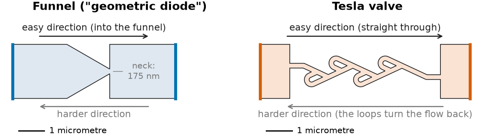

# A plain-language overview of this project

This page is for readers who are new to the topic. It explains what the
project set out to learn, how it went about it, and what it found, with as
little jargon as possible. The technical description of the code is in
[README.md](README.md), and the full write-up is the draft paper in
[paper/main.pdf](paper/main.pdf).

## The question in one sentence

**Can the shape of a tiny graphene channel, on its own, turn terahertz
radiation into usable electricity?**

The short answer this project arrives at is **no**.

## Some background

**Rectennas.** An antenna picks up radiation and turns it into an electric
current that swings back and forth, exactly as fast as the radiation itself
oscillates. To get useful direct current (DC), like the current from a
battery, you need a *rectifier*: a component that lets current pass more
easily in one direction than the other. An antenna joined to a rectifier is
called a *rectenna*. Rectennas already work well for radio waves and
microwaves, for example in wireless charging and contactless cards.

**Why terahertz is hard.** Terahertz radiation sits between microwaves and
infrared light. It oscillates around a trillion times per second. The usual
rectifier, a semiconductor diode, cannot keep up at that speed. So people
have been looking for a rectifier with no diode in it at all.

**Two ideas based on shape.** Graphene is a sheet of carbon one atom thick,
in which electrons move unusually fast and travel a long way before bumping
into anything. That has inspired two proposals in which the *shape* of the
channel is supposed to do the rectifying:

- **The funnel, or "geometric diode".** Electrons are herded through a
  funnel more easily one way than the other, much as a lobster pot lets
  lobsters in but not out.
- **The Tesla valve.** Nikola Tesla patented a pipe with side loops in 1920.
  Fluid passes straight through in one direction, but in the other direction
  the loops turn part of the flow back against itself. It is a one-way valve
  with no moving parts. In very clean graphene, electrons can flow like a
  thick liquid, so an electronic Tesla valve is a natural thing to try.

*The two shapes studied here, drawn to scale. Each device is about one tenth
as long as a human hair is wide. Current enters and leaves through the
coloured edges.*

## What we did

This is a **computer simulation** project. Nothing was built or measured.

Electrons in graphene can behave in three quite different ways, depending on
temperature, device size and how fast you push them. We wrote a separate
simulation for each, and ran the same shapes through all three:

1. **Like billiard balls.** Electrons fly in straight lines and bounce off
   the walls of the channel.
2. **Like a thick liquid.** Electrons collide with each other so often that
   they flow like honey.
3. **Like waves on that liquid.** At terahertz speeds the electron liquid
   sloshes back and forth, and ripples travel along the channel.

Before using each simulation, we tested it against problems whose exact
answers are known from theory or from published work. There are 44 such
tests in total, and all pass. Where a published measurement exists we
compared against it.

## What we found

**1. The funnel does rectify a steady current, and our model agrees with
experiment.** In the billiard-ball picture, the clean funnel passes 1.6
times more current one way than the other. A published experiment on the
same shape measured 1.66. With a more realistic amount of scattering inside
the graphene, the simulated figure drops to about 1.1.

**2. The Tesla valve does nothing when electrons act like billiard balls.**
Current is the same in both directions, within the noise of the simulation.
The loops only add resistance. A Tesla valve needs a fluid, and bouncing
particles are not one.

**3. When electrons flow like a liquid, the Tesla valve works in principle
but not in practice.** A Tesla valve only works when the fluid is moving
fast enough for its own momentum to matter. Electrons in graphene have a
speed limit, and they stop behaving like a liquid well before they reach the
speed the valve needs. Inside the range that is physically allowed, the
one-way effect is between 0.1 % and 3 %. One published experiment reports a
5 % effect at very small currents. Our model does not reproduce that result,
and we do not have an explanation for it.

**4. At terahertz frequencies the funnel does produce a DC current, but
because of how it is wired, not because of its shape.** If one end of the
device is fed by the antenna and the other end is connected differently, the
device rectifies. That is a known effect, and a plain straight strip wired
the same way would do it too. When we wire the funnel symmetrically, so that
only its shape can matter, the response nearly vanishes. The one exception
is a narrow range of frequencies where the taper acts like the horn of a
trumpet and helps the wave in. The Tesla valve contributes ten to twenty
times less than the funnel at every frequency.

**5. As a power source, the device is very inefficient.** At best, less than
1 % of the incoming terahertz power comes out as DC power. We tried changing
the two main design choices available (how many electrons are in the
graphene, and how close the control electrode sits). Neither raised that
ceiling. They only changed the power level at which the device stops
improving. Realistic electrical contacts make it several times worse.

**6. The last hope, the billiard-ball funnel driven at terahertz speed, also
falls short.** The funnel's one-way behaviour takes time to act, because
electrons need a few trillionths of a second to cross the device, and some
wander around for much longer. At terahertz speeds the radiation reverses
before many of them get through. In the most favourable case we could
construct, the funnel's shape gives about the same output as the wiring
effect in point 4, and no more.

**7. As a detector, the funnel is respectable.** Detecting a faint signal
is a much less demanding job than harvesting power from it. On paper, the
simulated funnel is about as sensitive as the best graphene terahertz
detectors that have been built and measured at room temperature. Commercial
detectors based on conventional diodes are still several times better.

## The bottom line

Shape alone does not make a graphene terahertz rectenna.

- The **funnel** is a decent terahertz *detector*, but its usefulness comes
  from the wiring and from acting as a horn, not from one-way behaviour. It
  is not an energy harvester.
- The **Tesla valve** is neither a detector nor a harvester in graphene.

A negative result like this is still useful. It tells people working on
these devices where the response really comes from, which design choices
matter (the wiring and the electrical contacts), and which do not (adding
Tesla loops).

## What to keep in mind

- **This is simulation, not experiment.** The models are checked against
  theory and against one measured number, but no device was built.
- **The models are idealised, and nearly always in the device's favour.**
  Perfect contacts, a perfect antenna connection and clean graphene were
  assumed unless stated. A real device should do worse, which makes the
  negative conclusion safer.
- **Some physics is left out.** In particular, real graphene detectors also
  respond because the radiation heats the electrons. That effect is not in
  our models. A mechanism outside the three we studied could behave
  differently.
- **The paper is a draft.** It has not been peer reviewed.

## Where to look next

| If you want | Go to |
|---|---|
| The full argument with figures | [paper/main.pdf](paper/main.pdf) |
| The tests each simulation had to pass | [paper/supplement.pdf](paper/supplement.pdf) |
| Detailed results, stage by stage | the `results/` folder, starting with [results/KILLTEST.md](results/KILLTEST.md) |
| How to build and run the code | [README.md](README.md) |

## A few terms

- **Graphene:** a sheet of carbon atoms one atom thick. Electrons move
  through it very fast and with little scattering.
- **Terahertz (THz):** radiation between microwaves and infrared light,
  oscillating about a trillion times per second.
- **Rectifier:** a component that passes current more easily one way than
  the other, turning a back-and-forth current into a one-way current.
- **Rectenna:** an antenna joined to a rectifier, used to turn radiation
  into DC electricity.
- **Detector versus harvester:** a detector only has to notice that
  radiation is there. A harvester has to convert a useful fraction of its
  power. The second is far harder.
