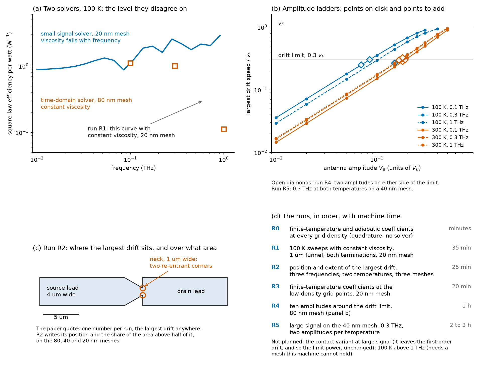

# Stage H7 (plan): closing the open points of the fluid model

Plan of 2026-11-21, for approval. Nothing below has been run. Figure:
`plans/hydro_closeout.png` (`tools/closeout_plan_fig.py`).

## 1. Why

After the eighth draft the fluid part of the paper has five statements
that rest on something not computed. Four of them can be closed with
runs of the solvers as they are; one needed no run and is done.

| # | Open point | What closes it |
|---|---|---|
| 1 | the drift limit of 0.3 v_F had no support | **done without a run**: `tools/drift_limit.py`, `results/thz2/drift_limit.md`, Sec. II and a new section of the supplement |
| 2 | the two solvers disagree at 100 K (panel a): 1.2, 2.6, 2.9 W^-1 against 1.1, 1.0, 0.11 W^-1 at 0.1, 0.3, 1 THz | R1 |
| 3 | where the largest drift sits, and whether the place is a mesh artefact | R2 |
| 4 | zero-temperature coefficients at the low-density edge of the grid, where the gas is least degenerate; the adiabatic remark of Sec. IV A is reasoned, not computed | R0, R3 |
| 5 | the powers at the drift limit are interpolated between ladder steps a factor 1.3 to 2 apart, on the 80 nm mesh | R4, R5 |

## 2. The runs

All with the code as committed, except R2, which needs the small-signal
solver to write where its largest drift is (a few lines in
`src/hydro/thz_solver.cpp` and two columns in the output of
`gd_thz_sweep`; no change to any computed number, checked by repeating
one existing sweep).

**R0. Coefficients at finite temperature (quadrature, minutes).** The
two coefficients of Eq. (8) for isothermal and for adiabatic flow at each
density of the grid and both temperatures, by the method of
`tools/momentum_step0.py`. Output: a table, and the inputs of R3.

**R1. 100 K with a constant viscosity (2 sweeps, 35 min).** The 1 um
funnel, both terminations, 25 frequencies, 20 nm mesh, `--tauee 0`. This
is the small-signal counterpart of what the time-domain solver
integrates. It separates the two possible causes of panel (a), the
viscoelastic term and the mesh, and it gives the curve a referee will ask
for in Fig. 6(b).

**R2. The largest drift (12 short runs, 25 min).** 0.1, 0.3 and 1 THz at
100 K and 300 K on the 80, 40 and 20 nm meshes: the position of the
largest first-order drift, its distance from the nearest corner in
elements, and the share of the device area in which the drift exceeds a
half and a quarter of the largest.

**R3. Finite-temperature coefficients on the grid (6 runs, 20 min).**
The valid grid points with the smallest E_F / k_B T: 2e11, 1e11 and 5e10
cm^-2 at 100 K (30 nm gate) and 5e11 cm^-2 at 300 K (three gates), with
the isothermal coefficients of R0, at 0.1, 0.3 and 1 THz on the 20 nm
mesh.

**R4. The ladder around the limit (10 amplitudes, about 1 h).** Two
amplitudes on either side of 0.3 v_F for the five ladders that step over
it (panel b; the sixth has a point at 0.296 v_F), 80 nm mesh, time
domain. The powers at the limit are then bracketed to about 10 % and no
longer interpolated across a factor of two.

**R5. Large signal on a finer mesh (4 amplitudes, 2 to 3 h).** 0.3 THz
at 100 K (amplitudes 0.05 and 0.1) and 300 K (0.1 and 0.18) on the 40 nm
mesh, time domain. The time is an estimate from the 80 nm runs (10 min
per amplitude) and the node count (2.2 times); the first amplitude will
be timed and the rest dropped if it exceeds 90 minutes.

At most two jobs at once on the 20 nm mesh, three on the 40 nm mesh and
six on the 80 nm mesh. Total machine time about five hours, most of it
unattended.

## 3. Guesses, registered before any run

1. **R1.** Without the viscoelastic term the 100 K response with the DS
   termination is unchanged at 0.1 THz (within 10 %), about 0.13 A/W at
   0.3 THz (0.20 now) and about 0.05 to 0.06 A/W at 1 THz (0.26 now). If
   so, the upper half of the paper's "0.05 to 0.26 A/W" exists only with
   the viscoelastic ansatz, and the abstract has to say so. The square-law
   efficiency per watt agrees with the time-domain solver to within the
   known mesh error (7 to 23 %).
2. **R2.** The largest drift is at one of the two re-entrant corners of
   the neck (panel c), within two elements of the corner; less than 5 %
   of the area is above half of it. If it is that local, the heating
   estimate of the supplement should use the whole-device figure, and the
   limit power is conservative with respect to the mean drift in the
   neck.
3. **R3.** The isothermal coefficients change the response at the
   low-density points by less than a quarter, as they do at the 300 K
   reference point (16 to 23 %).
4. **R4.** The powers at the limit move by less than 10 % from the
   interpolated values of the paper.
5. **R5.** The power at the limit moves by less than 15 % from the 80 nm
   mesh to the 40 nm mesh, and the efficiency per watt rises by the
   amount the small-signal mesh table gives (9 % at 100 K, 1 % at 300 K).

## 4. Not planned, with the reason

- **The contact variant at large signal.** The variant changes the
  boundary condition at second order only. The amplitude at which the
  first-order drift reaches 0.3 v_F is identical with and without it
  (ratio 1.000 at every frequency, both temperatures, 20 nm runs on
  disk), so the limit powers do not move, and the square-law level moves
  by the known 0.65 to 0.93. A time-domain run would add only the
  departure from the square law, at the cost of new solver code.
- **A finer ladder near v_F.** The estimates of point 1 place the failure
  of the model at 0.4 to 0.6 v_F. Refining the ladder between 0.9 and
  1.0 v_F would sharpen a number the paper should stop quoting as a
  bound; it already says the 0.09 % is one device and not a ceiling.
- **100 K above 1 THz.** No mesh in use is converged there, and the next
  one (10 nm at the walls, about 350 000 nodes) needs more memory than
  this machine has for even one job.
- **The half-response identity with corners at zero viscosity**, and
  **device D at 1 THz with a computed field**: separate questions, not
  needed for any statement of the paper as it stands.

## 5. What would change in the paper

Only after the runs and a separate go-ahead: one curve in Fig. 6(b) and
the sentences on the solver disagreement (R1); one sentence on where the
drift peaks and a line in the supplement's mesh table (R2); the grid
paragraph of Sec. IV C and the limitation on the coefficients (R0, R3);
the powers and efficiencies at the limit in Sec. IV B, Table III and
Fig. 7 (R4, R5).
