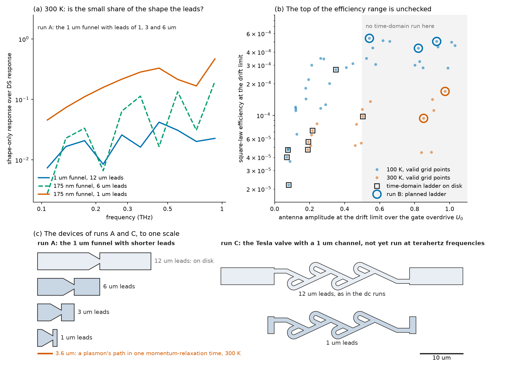

# Stage H8 (plan): three checks the referee read asked for

Plan of 2026-11-21, for approval. Nothing below has been run. Figure:
`plans/hydro_referee.png` (`tools/referee_plan_fig.py`).

Note added 2026-11-21, after the runs (results: `results/HYDRO_REFEREE.md`).
The text below is as approved, with one error left in place: section 2,
run C, quotes the valve's dc resistance as 0.6 and 1.9 kilohm. The dc
runs give 0.87 kilohm at 100 K and 2.86 kilohm at 300 K.

## 1. Why

The cold read of the ninth draft (`paper/review_ninth_draft.md`,
section 5) lists three cheap runs, b, c and d. Each stands behind a
sentence the tenth draft could only qualify, not support.

| Run | Statement of the paper it tests | What is on disk |
|---|---|---|
| A (b) | "At 300 K the shape gives 1.6 to 4.2 % of the response." The paper already says the 12 um leads may be the cause. | The 175 nm funnel gives 2 to 20 % with 6 um leads and 17 to 47 % with 1 um leads between 0.3 and 1 THz (panel a). The 1 um funnel exists with 12 um leads only. |
| B (c) | "The element converts at 1e-5 to 5e-4 at the drift limit." | The upper end is a square law at an antenna amplitude of 0.5 to 1.0 of the gate overdrive (panel b). Time-domain ladders exist at the reference point and at (5e11 cm^-2, 10 nm) only, all at 0.5 or below. |
| C (d) | "The Tesla valve does not rectify usefully in any case computed." | At terahertz frequencies the fluid model has the 175 nm valve only: 6 to 11 kilohm on a 75 ohm antenna. The 1 um valve was run at dc only. |

## 2. The runs

**A. The 1 um funnel with shorter leads (small signal, 20 sweeps,
about 30 min).** Leads of 1, 3 and 6 um on each side in place of 12 um,
nothing else changed (panel c). Both terminations, 300 K and 100 K,
20 nm mesh, the 25 frequencies of the paper's sweeps. With each length a
plain 4 um channel of the same full length, DS termination, as the
control the paper already uses at 12 um. One mesh check: the 1 um leads
at 300 K on the 40 nm mesh. The 100 K runs are included because they
cost ten minutes and "about a third at 100 K" is a statement of the same
kind; at 100 K the device is a resonator and its curves will move with
the length for that reason too, so only the 300 K result is a clean
test of the leads.

**B. Time-domain ladders at five thin-gate grid points (31 amplitudes,
1 to 1.5 h).** The points are circled in panel (b): the largest valid
efficiency of the grid, the largest amplitude, the point the text
quotes, and the top of the 300 K range.

| Set | n (cm^-2) | d (nm) | f (THz) | Square-law efficiency at the limit | Antenna amplitude at the limit over U_0 | Amplitudes, in units of the small-signal limit amplitude |
|---|---|---|---|---|---|---|
| 100 K | 5e11 | 5 | 0.3 | 5.1e-4 | 0.93 | 0.25 to 1.75 in steps of 0.25 |
| 100 K | 2e11 | 10 | 0.3 | 5.4e-4 | 0.54 | the same |
| 100 K | 1e12 | 5 | 0.3 | 4.4e-4 | 0.82 | the same |
| 300 K | 5e11 | 5 | 0.1 | 1.7e-4 | 0.97 | 0.25 to 1.25 in steps of 0.25 |
| 300 K | 1e12 | 5 | 0.3 | 0.9e-4 | 0.85 | the same |

The 80 nm mesh, as for every ladder so far. At these five points the
small-signal response on the 80 nm mesh is within 2 % of the 20 nm mesh
at 0.1 and 0.3 THz; at 1 THz it is not (0.24 to 0.85 of it), which is
why no ladder is planned at 1 THz. One check on the 40 nm mesh: the
first point of the table at 1.0 and 1.5 times the limit amplitude.

The 100 K ladders go further because the time-domain solver has a
constant viscosity, and Stage H7 showed that it then reaches 0.3 v_F at
a larger amplitude than the small-signal solver predicts (by 1.3 to 1.5
at the reference point). For the same reason the number to read from a
100 K ladder is not its efficiency against the paper's, which differ by
the viscosity model, but the ratio S of its efficiency to the square law
of the same solver on the same mesh, which the ladder output already
carries. A ladder stops at the first amplitude where the solver fails or
the density reaches zero; that amplitude is then the result.

**C. The Tesla valve with a 1 um channel (small signal, about 40
min).** The valve of the dc runs (every length of the 175 nm valve times
1000/175, four loops, 56.8 um end to end with its 12 um leads), and the
same valve with 1 um leads (panel c), so that at 300 K the wave reaches
the loops at all. Both terminations, both temperatures, the 25
frequencies of the paper's sweeps, 80 nm at the walls and 480 nm inside
(about 55 000 nodes; the 175 nm valve at the same relative resolution
had 97 000 with its leads). Mesh sequence at 0.1, 0.3 and 1 THz with 114
and 57 nm at the walls. A matched antenna at the same three frequencies,
since the valve's resistance, 0.6 kilohm at 100 K and 1.9 kilohm at
300 K in the dc runs, is still far from 75 ohm.

Code changes, all in the geometry catalogue (`apps/thz_geo.hpp`): the
funnel and the control channel with a lead length in the name, and the
short-lead valve from `tools/tesla_classic.py`. No solver code changes.
Check: one sweep on disk repeated with the rebuilt binary, identical to
the last digit.

At most three jobs at once on meshes above 50 000 nodes, eight in all.
Total machine time about two and a half hours, A and C first.

## 3. Guesses, registered before any run

1. **A, 300 K.** The share of the shape between 0.3 and 1 THz rises as
   the leads shorten: 0.02 to 0.10 with 6 um leads, 0.05 to 0.25 with
   3 um, and 0.2 to 0.6 with 1 um. The shape-only response itself rises
   at least fivefold from 12 um to 1 um leads. Reason: with the
   symmetric drive the wave is launched at the contacts and has lost all
   but exp(-12/3.6), about 4 %, of its intensity where the taper begins.
   If so, "a few per cent at 300 K" is a property of the leads, and the
   abstract, the introduction and the conclusion have to say that the
   shape and the circuit are comparable in a 300 K device shorter than
   the decay length.
2. **A, the control.** With the DS termination the funnel stays within
   0.7 to 1.2 of the plain channel of its own length at 300 K at every
   lead length (0.83 to 0.85 at 12 um).
3. **B.** Every ladder reaches 0.3 v_F without failing, with the
   smallest density above half of the mean. At 0.3 v_F the ratio S is
   between 0.9 and 1.3 at all five points, so the upper end of the
   efficiency moves by less than a third. On disk at (5e11, 10 nm): S
   is 1.01 at 100 K and 1.08 at 300 K at the limit, at half the amplitude
   over U_0 of the planned points. I am less sure of this guess than of
   the others: the Dyakonov-Shur law saturates as the amplitude nears
   U_0, which pulls S down, and the convective terms push it up.
4. **C, 300 K.** With 12 um leads the valve is indistinguishable from a
   channel: its shape-only response is below 1e-3 A/W up to 1 THz. With
   1 um leads it is below 5e-3 A/W, at least three times below what the
   funnel with 1 um leads gives in run A.
5. **C, 100 K.** The shape-only response of the valve is below 0.02 A/W
   between 0.1 and 1 THz for both lead lengths, against 0.06 to 0.09 A/W
   for the 1 um funnel. If the valve came out above the funnel anywhere
   in the band, the paper's verdict on it would have to change.

## 4. Not planned, with the reason

- **Ladders at 1 THz on the thin-gate points.** The 80 nm mesh is wrong
  there by up to a factor of four at 100 K, and a ladder on the 20 nm
  mesh is about 20 hours per point.
- **The 175 nm devices with other leads.** Two lead lengths are on disk
  (panel a) and the 100 K set is outside the fluid regime there.
- **The valve at large signal, and the valve with a computed field in
  the particle code** (run e of the review). The first is not needed
  unless guess 5 fails; the second is a different model and a large run.
- **Device D at 1 THz with a computed field** (run a). It is the one run
  that changes what the paper can say about long ballistic devices, and
  it needs its own plan.

## 5. What would change in the paper

Only after the runs and a separate go-ahead.

- **A:** the sentences on the 300 K split in the abstract, the
  introduction, Sec. IV A and the conclusion, with one table in the
  supplement (share against lead length). Possibly one panel.
- **B:** the upper end of the efficiency range wherever it is quoted
  (abstract, Sec. IV C, Table III, the design rule), and the phrase "at
  amplitudes not checked in the time domain".
- **C:** the valve paragraph of Sec. IV A, the "not computed" rows of
  Table III that concern the fluid model, and the wording of the verdict.

None of the three adds length if the present qualifications are removed
as the numbers go in.
