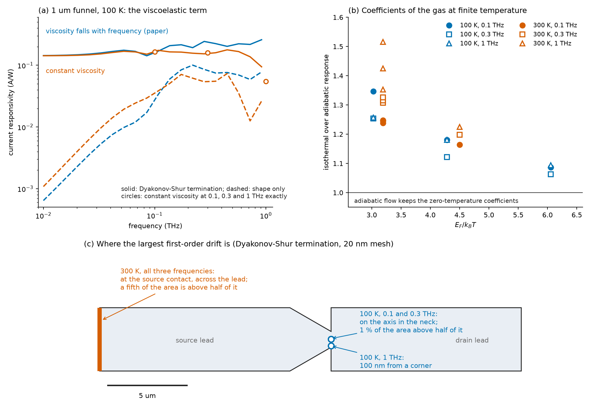

# Stage H7: the open points of the fluid model

Results of 2026-11-21. Plan and the guesses registered before the runs:
`plans/hydro_closeout.md`. Tables: `results/thz2/h7/tables.md`
(`tools/closeout_report.py`), `results/thz2/h7/ft_coeffs.md`
(`tools/closeout_coeffs.py`), `results/thz2/drift_limit.md`
(`tools/drift_limit.py`). Runs: `tools/closeout_runs.sh`.

The estimate of the drift limit (section 1) went into the paper before
the runs; the results of the runs were written into it afterwards, on
the same day (section 8).

## Summary

| # | Question | Answer | Guess |
|---|---|---|---|
| 1 | Is there support for the drift limit of 0.3 v_F? | Yes, to within 0.2 to 0.4 v_F; it is not conservative at 100 K | (none registered) |
| 2 | Why do the two solvers disagree at 100 K? | The viscoelastic term, and nothing else: with one viscosity they agree to the mesh error | right |
| 3 | How much of the 100 K response is the viscoelastic term? | The upper third of it: 0.09 to 0.18 A/W without, 0.14 to 0.26 A/W with | right at 0.1 and 1 THz, low at 0.3 THz |
| 4 | Where is the largest drift? | At 100 K in the middle of the neck (near a corner at 1 THz); at 300 K at the source contact | **wrong** |
| 5 | Do the adiabatic coefficients equal the zero-temperature ones? | Yes, to 6e-8 | right |
| 6 | How much do isothermal coefficients matter at low density? | 6 to 35 % at 100 K, 24 to 52 % at 300 K | **too low** (under a quarter) |
| 7 | Were the interpolated powers at the limit right? | Yes, to 1 % | right |
| 8 | Do they move with the mesh? | By 1 % in power; the efficiency at the limit rises 4 % at 100 K | right |

## 1. The drift limit (no run)

`results/thz2/drift_limit.md`. Three estimates of where a model with the
lattice temperature, linear friction and no optical phonons fails:

- **Phonon emission.** The edge of a Fermi sea drifting at beta v_F is
  spread in energy by 2 beta E_F (1 - beta^2)^(-1/4). It reaches the
  100 meV modes of hBN at beta = 0.41 at 1e12 cm^-2, 0.55 at 5e11 and
  0.77 at 2e11; the 160 meV phonon of graphene at 0.61, 0.77, 0.93.
- **Heating.** With the cooling time of 2.5 ps measured in encapsulated
  graphene at room temperature (Tielrooij et al. 2018), the electrons of
  the reference device at 300 K are 5 to 6 % hotter than the lattice on
  the device average at the limit, and up to 30 % hotter near the source
  contact (section 4 says why that bound applies there). At 100 K no
  cooling time is published; with 2.5 ps the average is 5 to 8 % above
  the lattice, with 10 ps 20 to 28 %, with 30 ps 52 to 71 %.
- **Measured saturation.** 0.6 v_F at 8e11 cm^-2 and room temperature in
  encapsulated graphene (Yamoah et al. 2017).

In the paper: Sec. II D, the limitations paragraph, a new section and
Table S14 of the supplement, two references.

## 2. The two solvers at 100 K (R1)

The small-signal solver lets the viscosity fall with frequency,
nu / (1 - i omega tau_ee); the time-domain solver keeps it constant.
With `--tauee 0` the small-signal solver has the constant one.

| f (THz) | efficiency per watt, small signal, constant viscosity, 20 nm (1/W) | time domain, 80 nm (1/W) | ratio | small signal, viscoelastic, 20 nm (1/W) |
|---|---|---|---|---|
| 0.1 | 1.17 | 1.10 | 1.06 | 0.99 |
| 0.3 | 1.10 | 1.01 | 1.10 | 2.43 |
| 1 | 0.130 | 0.112 | 1.16 | 2.42 |

The ratios of 1.06 to 1.16 are the error of the 80 nm mesh (7 to 23 %
in the supplement's mesh table). The first-order drift per unit amplitude
agrees in the same way: 3.6, 3.0 and 1.6 v_F per V_u against 3.6, 2.9 and
1.7 from the time-domain runs. **The two solvers are one model once the
viscosity is the same.** The paper's sentence that they are "not one
model at 100 K" stays true, but its cause is now known and single.

## 3. What the viscoelastic term carries (R1)

1 um funnel, 100 K, 20 nm mesh, 25 frequencies (panel a):

| | viscoelastic (paper) | constant viscosity |
|---|---|---|
| DS termination, 10 GHz to 1 THz (A/W) | 0.143 to 0.259 | 0.094 to 0.178 |
| DS termination, 0.3 to 1 THz (A/W) | 0.203 to 0.259 | 0.094 to 0.178 |
| DS termination at 1 THz exactly (A/W) | 0.237 | 0.055 |
| shape only, 0.2 to 1 THz (A/W) | 0.059 to 0.100 | 0.013 to 0.073 |
| share of the shape, 0.3 to 1 THz | 0.27 to 0.38 | 0.09 to 0.41 |
| NEP, 0.3 to 1 THz (pW/Hz^1/2) | 22 to 28; 24 at 1 THz exactly | 32 to 60; 103 at 1 THz exactly |
| power at the drift limit, 0.3 to 1 THz (uW) | 11 to 38 | 32 to 107 |
| efficiency at the drift limit, 0.3 to 1 THz | 2.2e-5 to 8.2e-5 | 3.2e-5 to 8.0e-5 |

Below 0.1 THz the two agree to 6 %. Above it the viscoelastic form
gives up to 2.7 times the response on the sweep grid and 4.3 times at
1 THz exactly, and the gap opens fastest between 0.7 and 1 THz, where
the constant-viscosity response falls from 0.14 to 0.055 A/W. Two things follow.

- **The upper end of the paper's "0.05 to 0.26 A/W" exists only with the
  viscoelastic form.** With a constant viscosity the 100 K funnel gives
  0.09 to 0.18 A/W up to 0.9 THz and 0.055 A/W at 1 THz, no better at
  1 THz than the 300 K device (0.053 to 0.066 A/W). The form is the
  standard one for omega tau_ee > 1, and omega tau_ee is 0.6 at 0.1 THz
  and 6 at 1 THz with the 100 K parameters, so it is the right choice
  where it matters; but it is an ansatz with one assumed time, and the
  paper should say what depends on it.
- **The efficiency at the drift limit keeps its range but not its
  values.** The viscoelastic form raises the response and the drift
  together, so the power at the limit falls as the efficiency per watt
  rises, and over 0.3 to 1 THz the two ranges nearly coincide (table).
  Frequency by frequency they differ: constant over viscoelastic is 0.5
  to 3.7 between 0.3 and 1 THz on the sweep, and at exactly 0.1, 0.3 and
  1 THz the efficiency at the limit is 3.0e-5, 4.1e-5 and 1.6e-5 with a
  constant viscosity against 2.2e-5, 4.0e-5 and 4.7e-5 with the
  viscoelastic form. The range of 1e-5 to 5e-4 in the abstract covers
  both.

## 4. Where the largest drift is (R2)

The paper quotes one number per run, the largest first-order drift
anywhere. Its position, DS termination, 20 nm mesh (panel c):

| set | f (THz) | where | distance to a neck corner | share of the area above half of it | rms over largest |
|---|---|---|---|---|---|
| 100 K | 0.1, 0.3 | on the axis in the neck | 490 nm (25 elements) | 1.4 %, 1.0 % | 0.33, 0.27 |
| 100 K | 1 | beside one neck corner | 100 nm (5 elements) | 0.3 % | 0.32 |
| 300 K | 0.1, 0.3, 1 | at the source contact, across the lead | 14.6 um | 26 %, 21 %, 19 % | 0.41, 0.38, 0.36 |

- At 100 K and up to 0.3 THz the place is the same on the 80, 40 and
  20 nm meshes and the value moves by 1 to 3 %. It is a property of the
  flow through the neck, not of a corner.
- At 100 K and 1 THz it sits at a re-entrant corner and the 80 nm mesh
  is 11 % low (3.67 against 4.14 v_F per V_u). This is the 13 % of the
  supplement's mesh paragraph, now with its cause.
- **At 300 K the drift limit is reached in the lead at the antenna, not
  in the funnel.** The plasmon is damped along the 12 um source lead
  (friction number 1.1), so the drift is largest where the wave enters.
  The limit powers at 300 K (100 to 130 uW) are therefore a property of
  a 4 um lead under a 75 ohm source and would be the same for the plain
  channel. This also places the heating: a fifth of the device, several
  cooling lengths long, drifts at more than half the limit, so the
  electrons near the source are near the upper bound of section 1.
- With the symmetric termination the picture is the same at 100 K up to
  0.3 THz; at 300 K the place changes with frequency (neck, source
  contact, drain contact at 0.1, 0.3 and 1 THz).

The rebuilt app changes no computed number (responsivity and drift equal
to the last digit against the grid run of the same point).

## 5. Coefficients at finite temperature (R0, R3)

`ft_coeffs.md`. Momentum conservation to second order gives
c_div = 1 - d ln(rho) / d ln(n) along the path of the flow.

- **Adiabatic flow keeps the zero-temperature pair (-1/2, -1/4) at any
  temperature.** The entropy per carrier depends on mu / k_B T alone, so
  the mass density goes as n^(3/2) on an adiabat. Followed numerically
  without using that, the coefficient is -1/2 to 6e-8 at all ten points.
  The remark in Sec. IV A is now computed. What does change with
  temperature is the inertial mass (1.03 to 1.43 times its zero-temperature
  value at 100 K over the grid, 1.2 to 3.2 times at 300 K), which the
  model takes from the mobility.
- **Isothermal flow gives Svintsov's c_div = 1 - 2 xi**, confirmed
  numerically to 2e-7. The second coefficient depends on which
  temperature is held: (1 - 2 xi) / 2 for the temperature parameter of
  the drifting distribution (Svintsov, used in the runs), -xi / 3 for
  the rest-frame temperature. At 300 K and 1e12 cm^-2 these are -0.17
  and -0.22.
- **The isothermal pair matters more at low density than the paper
  allows for** (panel b). Response with the isothermal pair over the
  default, at 0.1, 0.3 and 1 THz:

  | set | n (cm^-2) | E_F / k_B T | ratio |
  |---|---|---|---|
  | 100 K | 2e11 | 6.1 | 1.06 to 1.09 |
  | 100 K | 1e11 | 4.3 | 1.12 to 1.18 |
  | 100 K | 5e10 | 3.0 | 1.25 to 1.35 |
  | 300 K | 1e12 (Stage H6) | 4.5 | 1.16 to 1.23 |
  | 300 K | 5e11, three gates | 3.2 | 1.24 to 1.52 |

  The amplitude at the drift limit is unchanged (the coefficients enter
  at second order). So the best noise figures of the grid, which are at
  the lowest density, are uncertain by up to a third in the favourable
  direction: the NEP of 1.3 pW/Hz^1/2 at 5e10 cm^-2 would be 1.0 to 1.1
  with the isothermal pair. A flow at 0.1 to 1 THz with a cooling time of
  2.5 ps or more is nearer adiabatic than isothermal, which is the
  default.

One correction to my own first attempt: I first wrote the isothermal
coefficient as -(1/w) dP/d ln(n), from the Euler equation of an ideal
relativistic fluid. That equation already uses the conservation of
energy and holds for adiabatic flow only; for isothermal flow the
momentum equation has to be used directly. The script and its table have
the corrected form, which agrees with Svintsov.

## 6. The powers at the drift limit (R4)

Two amplitudes within 4 % of the crossing on five ladders and one on the
sixth, 80 nm mesh:

| set | f (THz) | power at the limit, interpolated before (uW) | bracketed now (uW) | efficiency there | over the square law |
|---|---|---|---|---|---|
| 100 K | 0.1 | 26.2 | 26.1 | 2.9e-5 | 1.02 |
| 100 K | 0.3 | 37.8 | 37.8 | 4.0e-5 | 1.06 |
| 100 K | 1 | 104 | 105 | 1.3e-5 | 1.08 |
| 300 K | 0.1 | 133 | 134 | 6.4e-5 | 1.06 |
| 300 K | 0.3 | 108 | 108 | 5.1e-5 | 1.06 |
| 300 K | 1 | 102 | 102 | 3.8e-5 | 1.06 |

The drift is linear in the amplitude to within a per cent up to the
limit, so the interpolation was sound. The numbers of the paper stand.

## 7. The mesh at large signal (R5)

0.3 THz, 40 nm mesh (41 509 nodes) against 80 nm, same amplitudes:

| set | drift | power at the limit | efficiency at equal power | efficiency at the limit |
|---|---|---|---|---|
| 100 K | 1.006 | 0.987 | 1.054 | 1.041 |
| 300 K | 0.9985 | 1.003 | 0.992 | 0.995 |

At 0.3 THz the limit powers and efficiencies of the paper are converged
to 1 % and 4 %. The square-law level at 100 K rises by 6 % from 80 to
40 nm, as the small-signal table predicts. The run took 14 to 22 minutes
per amplitude, far less than the plan allowed. 1 THz at 100 K, where the
80 nm mesh is 11 to 16 % low (sections 2 and 4), was not run on the
finer mesh.

## 8. What this changed in the paper (done on 2026-11-21, ninth draft)

1. **Abstract, introduction, discussion, conclusion, Table III:** where
   the range 0.05 to 0.26 A/W is quoted, a clause that the part above
   0.18 A/W needs a viscosity that falls with frequency. Table IV has a
   second 100 K row for a constant viscosity (0.09 to 0.18 A/W, 32 to 60
   pW/Hz^1/2).
2. **Sec. IV A:** the viscosity is varied in magnitude and in its
   dependence on frequency; the constant-viscosity numbers; dotted
   curves in Fig. 6(b); the adiabatic pair is the zero-temperature pair
   exactly, and why the flow is nearer adiabatic.
3. **Sec. IV B:** the two solvers differ by the viscoelastic term and
   the mesh and by nothing else; the powers at the limit are bracketed
   (105 in place of 104 uW at 1 THz, 100 K) and checked on the 40 nm
   mesh; the efficiency at the limit in the two solvers; where the
   largest drift is, and that at 300 K the limit is reached in the lead.
4. **Sec. IV C:** the grid values carry the viscoelastic term (three
   times lower efficiency at the limit at 1 THz without it); isothermal
   coefficients at the low-density points and what they do to the best
   NEP.
5. **Limitations paragraph, Appendix C, Sec. II D:** the cause of the
   solver difference; the heating near the source contact.
6. **Supplement:** a part "Checks made after the eighth draft" with the
   solver comparison, the ladder and the 40 nm runs, Table S14 (where
   the largest drift is) and Table S15 (isothermal coefficients on the
   grid); the heating paragraph says which bound applies where. The
   table of the drift limit is now S16.

Fig. 7 is unchanged: the new ladder points lie on its curves.

## 9. Not done

- The contact variant at large signal, a finer ladder near v_F, 100 K
  above 1 THz, the half-response identity with corners at zero
  viscosity, device D at 1 THz with a computed field: not planned, for
  the reasons in the plan.
- 1 THz at 100 K on a finer mesh at large signal (section 7).
- A measured cooling time at 100 K for the heating estimate.
- The author list of Yamoah et al. 2017 (only the abstract was reached).
