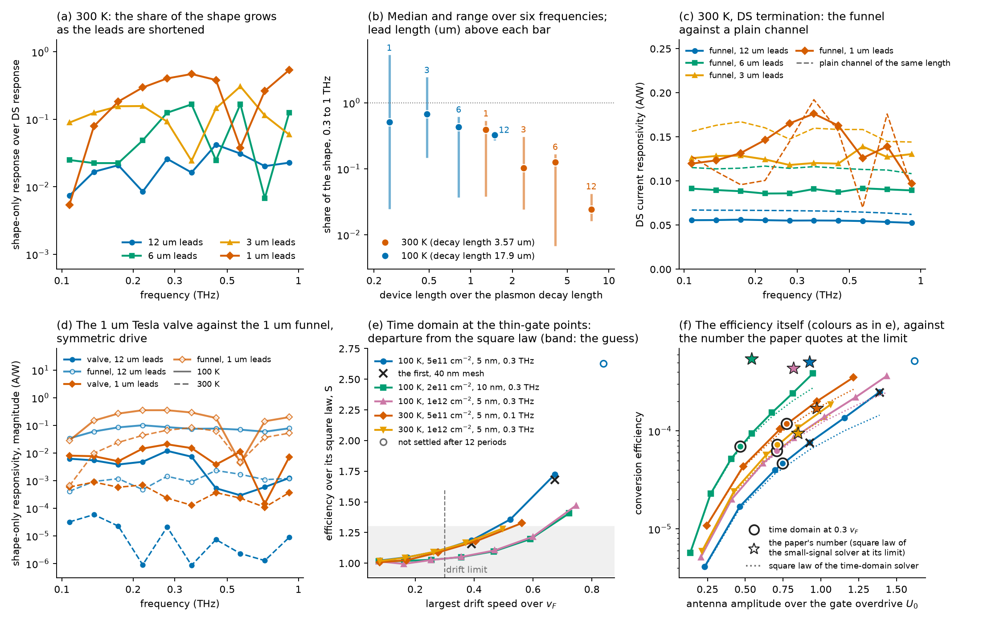

# Stage H8: three checks the referee read asked for

Results of 2026-11-21. Plan and the guesses registered before the runs:
`plans/hydro_referee.md`. Tables: `results/thz2/h8/tables.md`
(`tools/referee_report.py`). Runs: `tools/referee_runs.sh`. Figure:
`tools/referee_fig.py`.

Nothing in the paper has been changed. Section 5 lists what these
results would change in it.

## Summary

| # | Question | Answer | Guess |
|---|---|---|---|
| A | Is "a few per cent at 300 K" a property of the 12 um leads? | Yes. The share of the shape is 2 to 4 % with 12 um leads and 4 to 54 % (median 39 %) with 1 um leads | direction right, all three ranges **wrong** |
| A | Does the DS funnel stay close to a plain channel of its own length? | At 12, 6 and 3 um leads, yes (0.75 to 0.91). With 1 um leads both resonate and the ratio is 0.79 to 1.8 | right at three lengths, **wrong** at 1 um |
| B | Does the square law hold up to the drift limit at the thin-gate points? | Yes: all 31 steps converge, and the efficiency is 1.04 to 1.12 of the square law at 0.3 v_F | right |
| B | Is the efficiency the paper quotes at the limit reached? | No. At 300 K the time-domain value is 0.70 and 0.77 of it. At 100 K it is 0.09 to 0.14 of it | (not registered) |
| B | What is the rest of the 100 K gap? | The viscoelastic term, and nothing else: it carries 81 to 87 % of the paper's efficiency at these points | (not registered) |
| C | Does the 1 um Tesla valve rectify at terahertz frequencies? | No. Shape only, at most 9e-4 A/W at 300 K and 0.021 A/W at 100 K; efficiency at the drift limit at most 2.4e-6 | right at 300 K; at 100 K right with 12 um leads, **marginally wrong** with 1 um (0.0206 against 0.02) |
| C | Is the valve above the funnel anywhere? | At one of forty points: 0.57 THz, 100 K, 1 um leads, where the funnel's response changes sign | (the test the plan named) |

All 60 sweeps of runs A and C, all 31 amplitudes of run B and the six
solves added on 2026-11-22 (section 2) completed. No log has an error or
a failed step.

## 1. Run A: the 1 um funnel with shorter leads

Small signal, 20 nm mesh, both terminations, 25 frequencies. "Share" is
the magnitude of the shape-only response over the DS response.

### 300 K

| leads (um) | device length over the 3.6 um decay length | share, 0.3 to 1 THz: smallest / median / largest | shape-only response (A/W) | DS response (A/W) | dc resistance (ohm) |
|---|---|---|---|---|---|
| 12 | 7.5 | 0.016 / 0.024 / 0.042 | 9.0e-4 to 2.3e-3 | 0.053 to 0.055 | 582 |
| 6 | 4.1 | 0.007 / 0.125 / 0.167 | 6.2e-4 to 0.015 | 0.086 to 0.092 | 364 |
| 3 | 2.4 | 0.024 / 0.103 / 0.307 | 2.9e-3 to 0.043 | 0.118 to 0.139 | 255 |
| 1 | 1.3 | 0.038 / 0.392 / 0.536 | 4.8e-3 to 0.082 | 0.097 to 0.176 | 179 |

- **The split at 300 K is set by the leads.** The paper's "1.6 to 4.2 %"
  is the 12 um row. With leads of 1 um the shape gives about 40 % of the
  response at most frequencies and over half at 0.9 THz.
- **The short devices resonate at 300 K too.** With 3 um and 1 um leads
  the shape-only response changes sign inside the band, so the share has
  deep minima. That is why every range of guess 1 fails at its lower
  end, and why the fivefold rise fails at one frequency (2.8 times at
  0.57 THz; 2.8 to 92 over the band).
- **The control.** DS funnel over plain channel of the same length: 0.83
  to 0.85 (12 um), 0.75 to 0.83 (6 um), 0.75 to 0.91 (3 um), 0.79 to 1.8
  (1 um). The paper's statement that the funnel with a DS termination is
  a slightly worse channel holds down to 3 um leads. At 1 um both
  devices are resonators with different resonances.
- **The efficiency does not move.** At the drift limit, DS termination,
  75 ohm: 1.5e-5 to 1.1e-4 at every lead length. The shorter devices
  respond more per watt but reach the limit at less power (about 120 uW
  with 12 um leads, 23 to 77 uW with 1 um).
- **Mesh.** With 1 um leads at 300 K the 40 nm mesh gives the DS
  response to 0.5 to 1.7 % of the 20 nm mesh. The shape-only response
  moves by at most 1.8 % of the DS response.

### 100 K

Every device is a resonator at 100 K (decay length 17.9 um), so the
curves move with the length for that reason as well. Share between 0.3
and 1 THz: 0.27 to 0.38 (12 um), 0.04 to 0.61 (6 um), 0.15 to 2.4
(3 um), 0.03 to 5.3 (1 um). The paper's "about a third at 100 K" is
likewise the 12 um row. The plain channels with short leads have large
negative DS responses (down to -2 A/W), so the funnel-over-channel ratio
is not a usable control at 100 K.

## 2. Run B: time-domain ladders at five thin-gate points

Funnel with 12 um leads, DS termination, 80 nm mesh, constant viscosity.
S is the efficiency over the square law of the same solver on the same
mesh. Va_lim is the amplitude at which the small-signal solver puts the
first-order drift at 0.3 v_F; the paper's efficiency at the limit is its
square law at that amplitude.

| set | n (cm^-2) | d (nm) | f (THz) | steps converged | S at 0.3 v_F | amplitude at 0.3 v_F over Va_lim | smallest density (of the mean) | efficiency at 0.3 v_F | the paper's | ratio |
|---|---|---|---|---|---|---|---|---|---|---|
| 100 K | 5e11 | 5 | 0.3 | 7 of 7 | 1.12 | 0.80 | 0.81 | 4.7e-5 | 5.1e-4 | 0.092 |
| 100 K | 2e11 | 10 | 0.3 | 7 of 7 | 1.04 | 0.86 | 0.83 | 7.0e-5 | 5.4e-4 | 0.128 |
| 100 K | 1e12 | 5 | 0.3 | 7 of 7 | 1.04 | 0.86 | 0.83 | 6.3e-5 | 4.4e-4 | 0.144 |
| 300 K | 5e11 | 5 | 0.1 | 5 of 5 | 1.11 | 0.80 | 0.75 | 1.2e-4 | 1.7e-4 | 0.70 |
| 300 K | 1e12 | 5 | 0.3 | 5 of 5 | 1.12 | 0.84 | 0.82 | 7.2e-5 | 9.4e-5 | 0.77 |

- **Guess 3 holds in all three parts.** Every ladder passes 0.3 v_F, the
  density stays above three quarters of its mean there, and S is 1.04 to
  1.12. The square law is good to 12 % at the limit at amplitudes of
  0.47 to 0.77 of the gate overdrive.
- **The limit is reached at a lower amplitude than the paper assumes.**
  The largest drift grows faster than the amplitude: it is 3 to 9 %
  above the small-signal value at the lowest step and 19 to 35 % above
  it at Va_lim (0.36 to 0.41 v_F there). So 0.3 v_F is reached at 0.80
  to 0.86 of Va_lim, which is 0.63 to 0.75 of the power. The plan
  expected the opposite at 100 K, from Stage H7 at the reference point.
- **At 300 K the two solvers are one model, and the paper's number is
  25 to 30 % high.** Their square laws agree to 1.5 %. The ratio of 0.70
  and 0.77 is the lower power (0.63, 0.70) times S (1.11, 1.12).
- **At 100 K the gap is a factor of 7 to 11, and most of it is the
  viscoelastic term.** Six small-signal solves with a constant
  viscosity, approved and run on 2026-11-22
  (`tools/referee_runs.sh bss`), settle this:

  | n (cm^-2) | d (nm) | square-law efficiency per watt (1/W): viscoelastic, 20 nm (paper) | constant, 20 nm | constant, 80 nm | time domain, 80 nm | constant over viscoelastic |
  |---|---|---|---|---|---|---|
  | 5e11 | 5 | 25.0 | 3.31 | 3.26 | 3.18 | 0.133 |
  | 2e11 | 10 | 122 | 21.0 | 20.8 | 20.3 | 0.171 |
  | 1e12 | 5 | 6.84 | 1.31 | 1.30 | 1.27 | 0.192 |

  With one viscosity the small-signal solver and the time-domain solver
  agree to 2.0 to 2.6 % on one mesh, and the 80 nm mesh is within 2 % of
  the 20 nm mesh. The whole model factor is the viscoelastic term. At
  the reference point it carried the upper third of the response
  (Stage H7); at the thin-gate points, where the paper's largest
  efficiencies are, it carries 81 to 87 % of the efficiency.
- **The drift per volt does not depend on the viscosity here.** It
  differs by 1 to 3 % between the two forms, against a factor of 1.3 to
  1.5 at the reference point. So the limit amplitude is the same, and
  the small-signal solver with a constant viscosity gives 6.3e-5 to
  9.6e-5 at its own limit, against 4.4e-4 to 5.4e-4 with the
  viscoelastic form.
- **Above the limit** S rises to 1.2 to 1.7 between 0.56 and 0.75 v_F. The top
  step of the first ladder (0.84 v_F, S 2.6) had not settled after 12
  periods and is drawn hollow in the figure.
- **Mesh.** At (5e11, 5 nm), 100 K, the 40 nm mesh gives S of 1.155 and
  1.680 against 1.186 and 1.723 on the 80 nm mesh, and the same drift to
  0.3 %.
- **Settling.** Up to 0.45 v_F the dc output changes by at most 2.1 %
  over the last period. At 300 K the extrapolation of the period means
  corrects it by up to 8 %, so I take S at 300 K as good to 5 to 8 %.

## 3. Run C: the Tesla valve with a 1 um channel

Small signal, 80 nm at the walls, both terminations, 25 frequencies.

| | 12 um leads | 1 um leads |
|---|---|---|
| dc resistance, 300 K / 100 K (ohm) | 2863 / 873 | 2451 / 788 |
| shape-only response, 300 K, up to 1 THz (A/W) | at most 5.9e-5 | at most 8.8e-4 |
| shape-only response, 100 K, 0.1 to 1 THz (A/W) | 2.9e-4 to 0.012 | 1.5e-4 to 0.021 |
| DS response, 300 K (A/W) | 0.010 to 0.011 | 0.009 to 0.022 |
| DS response, 100 K (A/W) | 0.021 to 0.050 | 0.024 to 0.091 |
| valve over funnel with the same leads, shape only, 100 K | 0.004 to 0.18 | 0.001 to 0.28, and 2.5 at 0.57 THz |

- **300 K.** With 12 um leads the valve's shape-only response is at the
  level of numerical noise. With 1 um leads the funnel is 21 to 640
  times above it between 0.3 and 1 THz. Guess 4 holds.
- **100 K.** The valve is 4 to 1000 times below the funnel with the same
  leads at 19 of 20 points (at 300 K it is below at all 20). The one exception is a sign change of the
  funnel's response, not a peak of the valve's. Guess 5 fails by 3 % for
  the 1 um leads (0.0206 against 0.02 A/W) and holds for 12 um.
- **Efficiency at the drift limit.** Shape only: at most 9.7e-8 at 300 K
  and 2.4e-6 at 100 K. With the DS termination 1e-6 to 3.6e-5; the
  valve's DS response at 300 K is 0.2 of the funnel's with 12 um leads
  and 0.06 to 0.14 of it with 1 um leads. A matched antenna does not
  change this (at most 4e-5 DS, 2.2e-6 shape only).
- **Mesh.** With 114, 80 and 57 nm at the walls the DS response is
  converged to 1 % (5 % at 1 THz, 100 K). The shape-only response is
  **not** converged at 1 THz: it changes by a factor of two or more from
  mesh to mesh, and moves by 4 to 26 % at 0.1 and 0.3 THz. The valve's
  shape-only numbers are upper bounds of the right order, not values.
  The verdict does not depend on them to better than that.

## 4. Departures from the plan

- **The valve's dc resistance was misquoted in the plan** (0.6 and
  1.9 kilohm). The dc runs give 868 ohm at 100 K and 2857 ohm at 300 K
  (`results/dcgate2/D3.csv`); the new sweeps give 873 and 2863 ohm. A
  dated note is in the plan.
- **One helper outside the geometry catalogue.** `apps/thz_mesh.cpp`
  (and one line of the `Makefile`) creates a mesh and prints its size
  without solving, so that parallel jobs never write the same mesh file.
  No solver code changed. The rebuilt sweep reproduces a sweep on disk
  exactly in every shared column.
- **Three more three-frequency sweeps per valve** than planned, because
  a matched-antenna output holds the matched pass only and the mesh
  sequence needs the 75 ohm one.
- **A third factor was added to the report of run B** after the runs:
  the split of the gap to the paper's number into model, amplitude and
  S (`tables.md`, "The three factors").
- **Six small-signal solves were added** on 2026-11-22, with approval,
  to test the attribution of the 100 K gap (section 2).

## 5. What would change in the paper

Written into the paper on 2026-11-22 (eleventh draft), after the
go-ahead. Beyond the three items below, the revision had to change two
statements this list did not foresee: the discussion and the conclusion
said that shape-based rectification at room temperature is found in one
regime only, and compared the ballistic funnel with a fluid circuit term
of 0.05 to 0.07 A/W. With 1 um leads the fluid funnel's shape gives up
to 0.08 A/W at 300 K and its terminations 0.10 to 0.18 A/W, so both now
name the short fluid funnel as a second case. New in the paper: Tables
II and III of the main text, and a section with Tables S16 to S18 in the
supplement.

- **A.** "At 300 K the shape gives 1.6 to 4.2 %" becomes a statement
  about a device 7.5 decay lengths long. In a device of 1.3 decay
  lengths the shape and the circuit are comparable (median 39 %).
  Abstract, introduction, Sec. IV A, conclusion; one supplement table.
  The efficiency range is unchanged.
- **B.** The upper end of the efficiency range. At 300 K it falls from
  1.7e-4 to 1.2e-4. At 100 K the time-domain model gives 5e-5 to 7e-5
  where the paper quotes 4e-4 to 5e-4. The paper's 100 K numbers above
  1e-4 exist only with the viscoelastic term, at an amplitude where that
  term has been checked in the small-signal solver alone; the paper
  should say so wherever it quotes 5e-4, and give the constant-viscosity
  value beside it. The limitations paragraph says the viscosity decides
  "the upper third of the 100 K responsivities, and by a factor of three
  to four the efficiency at the drift limit at 1 THz"; that holds for
  the reference device only. At the thin-gate points it decides the
  efficiency at the limit by a factor of five to eight at 0.3 THz. The phrase "at amplitudes not checked in the time domain"
  can go for 300 K.
- **C.** The valve paragraph of Sec. IV A and the "not computed" rows of
  Table III now have numbers; the verdict stands.

## 6. Open

- **A large-signal check of the viscoelastic term.** The time-domain
  solver has a constant viscosity, so no run on disk tests the square
  law at 100 K with the term that carries most of the efficiency. That
  needs a solver change (a relaxation equation for the viscous stress)
  and its own plan.
- The valve's shape-only response at 1 THz on a finer mesh, if a value
  rather than a bound is ever wanted.
